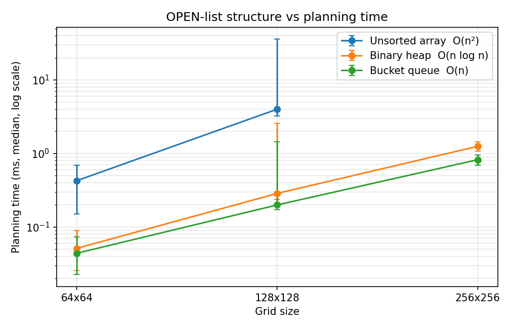

# Grid-Based Drone Path Planning Simulation

**Live demo: https://drone-path-planning-ruby.vercel.app/**

DSA-II individual project. B.Tech CSE, 3rd semester, NIET Greater Noida.

A drone crosses a map of square cells and reaches its goal without flying through anything blocked. What this project actually measures is one level below that: how much of a planner's speed comes from the data structure holding its frontier, rather than from the algorithm on top.

## The gap this addresses

My base paper is [Gao, Li and Pang (2026)](https://doi.org/10.1038/s41598-026-45160-6), *Scientific Reports* 16:18275. They report a 46.2 per cent cut in computation time for an A\*-APF planner.

Every result in that paper is a time in seconds. But the paper describes its OPEN list only in words ("the node with the lowest cost is selected for expansion") and never says what structure holds it. Picking the minimum costs O(n) from an array, O(log n) from a heap, or O(1) from a bucket queue. So part of any reported speed could be coming from the structure, and there is no way to tell from the paper.

This project holds A\* fixed and swaps only the OPEN list.

## Build and run

```bash
make            # builds planner, tests, mission, scaling and the demo server
make test       # correctness suite, ten tests
make bench      # writes results.csv
make serve      # demo backend on http://127.0.0.1:8080
python3 scripts/plot.py    # charts from the CSV
```

Requires g++ with C++17. Built with `-O2`. Comparing an unoptimised build against an optimised one gives a meaningless result, so the flag is fixed in the Makefile and quoted in the report.

## What makes the comparison valid

Everything hangs on one interface:

```cpp
class OpenList {
    virtual void insert(int cell, int f) = 0;
    virtual int  extract_min()           = 0;
    virtual bool empty() const           = 0;
};
```

A\* calls these three and knows nothing about what sits behind them. Swapping the implementation changes no line of the search, so a runtime difference is attributable to the structure and not to two different programs.

Three implementations:

| Class | Insert | Extract-min | Whole search |
|---|---|---|---|
| `UnsortedArrayOpenList` | O(1) | O(n) | O(n²) |
| `BinaryHeapOpenList` | O(log n) | O(log n) | O(n log n) |
| `BucketQueueOpenList` | O(1) | O(1) amortised | O(n) |

The bucket queue works because of a property of grids that general graph algorithms cannot assume: edge weights take exactly two values, 1000 and 1414 after integer scaling. All f-values lie on a bounded integer lattice, and under a consistent heuristic A\* expands in non-decreasing f order, so live keys stay inside a fixed window. Those are Dial's preconditions.

## Results

20% obstacle density, 10 maps per configuration, 5 repetitions each, cold run discarded, medians reported.

| Structure | 64×64 | 128×128 | 256×256 |
|---|---|---|---|
| Unsorted array | 0.303 ms | 3.421 ms | not run |
| Binary heap | 0.042 ms | 0.244 ms | 1.085 ms |
| Bucket queue | 0.028 ms | 0.144 ms | 0.568 ms |

**Speedup over the array baseline:** about 7× at 64², rising to **14× (heap)** and **24× (bucket)** at 128². The gap widens with size, which is what O(n²) against O(n log n) predicts.

These are wall-clock times on one machine. Re-run `make bench` on yours and the absolute milliseconds will differ; the ratios are the part that holds.

**Scaling when the grid doubles** (4× the cells):

| Structure | 64→128 | 128→256 | Expected |
|---|---|---|---|
| Unsorted array | 11.3× | not run | super-linear, O(n²) |
| Binary heap | 5.8× | 4.4× | ~4× plus a log factor |
| Bucket queue | 5.0× | 4.0× | ~4×, linear |

The 64→128 column is noisy because a 64×64 plan finishes in tens of microseconds. The 128→256 column is the one to read.

The bucket queue tracks 4× almost exactly. That is the log factor disappearing, visible in measurement.

**Bucket vs heap:** 14% faster at 64², 30% at 128², 34% at 256².



## Two findings I did not expect

**Tie-breaking matters more than I assumed.** On the same map the heap expanded 62 nodes and the bucket queue 32, a 48% difference with identical path cost. Both are correct. They differ because the bucket queue pops LIFO within a bucket, which biases exploration toward recently discovered cells and therefore toward the goal. Tie-breaking deserves treating as a factor in its own right, not a detail.

**My insert-to-extract estimate was wrong.** I had assumed roughly 8:1, since each expansion generates up to 8 neighbours. Measured it is **1.20:1**. Most neighbours are rejected before insertion, already closed, blocked, or not an improvement on a known `g`. The argument for favouring cheap insertion is therefore much weaker than I wrote in the report, and that section needs correcting.

## A bug the tests caught

The first bucket queue used `C + 1` buckets, taking the Dijkstra bound where a successor key exceeds the current minimum by at most one edge cost. It returned suboptimal paths: 43006 against the heap's 41592 on the same map.

For A\* with a consistent heuristic the bound is twice that:

```
f_v = g_u + c + h_v = f_u − h_u + c + h_v,   and  h_v − h_u ≤ c
⇒ f_v ≤ f_u + 2c
```

At `C + 1` the distant keys aliased onto occupied buckets and cells came out in the wrong order. Fixed to `2C + 1`. Found only because the test suite checks that all three structures return the same cost on 50 random maps, no single-structure test would have caught it.

## The hosted demo

[drone-path-planning-ruby.vercel.app](https://drone-path-planning-ruby.vercel.app/) runs
`demo/index.html`. Pick one of three fixed maps, or draw your own on a 100 x 100 grid with
buildings, trees and blocked zones, place the start and the delivery point, and watch A\* search.
A dialog then names every algorithm and data structure the run used, with that run's own numbers.

One thing to be clear about, because it matters for what the numbers mean: **the hosted page plans
in JavaScript, not in C++.** Vercel serves static files and cannot run a compiled binary, so the
page carries its own implementation of the same A\* and the same binary min-heap. Every measured
figure quoted in this README and in the report comes from the C++ build at `-O2` via
`make bench`, not from the browser. The browser is several times slower and its timing varies with
whatever else the machine is doing.

The same page is also in the repository twice on purpose:

- `demo/index.html` is the standalone build. It needs no server, so it is what gets deployed and
  what opens if you double-click it.
- `web/index.html` is the build that talks to the C++ backend below. It plans by asking
  `./server`, and replays the expansion order the engine actually produced rather than running a
  second search of its own.

## The demo backend

`make serve` starts a small HTTP server and `web/index.html` becomes an interactive demonstration:
pick one of three hand-built maps, pick a start and a delivery point, and watch the planner work.

The page does no planning. It asks this program, and the answer comes from the same `astar()` and
the same six OPEN-list structures that produce `results.csv`. The animation is not a re-run in
JavaScript that happens to agree — the server returns the order in which A* actually closed its
cells, and the browser replays that.

```
GET /                    the demo page
GET /api/scenarios       the three maps, their cells and their start/end points
GET /api/plan?scenario=river&start=0&end=2&structure=1
GET /api/compare?scenario=river&start=0&end=2     the same route with all six structures
```

The server is POSIX sockets and hand-written JSON, with no dependencies, so there is nothing to
install before a demonstration. It binds to loopback only.

Opened straight from disk with no server running, the same page falls back to a JavaScript
planner so it still works; a badge on the page says which engine answered, and the figures it
reports are labelled accordingly.

One honest wrinkle worth knowing before anyone asks: on these 40 x 40 demo maps the bucket queue
is *not* the fastest, though it is on the 128 x 128 benchmark. Its window is 2C+1 = 2829 buckets
whatever the map size, and on a search of about a thousand expansions that setup is not yet paid
off. The benchmark maps are where the comparison belongs; the demo maps are there to be
recognised, not to rank structures.

## Tests

```
Test 1   empty grid, corner to corner: cost is exactly 9 diagonal steps (12726)
Test 2   all three structures agree on cost across 50 random maps
Test 3   no path through a solid wall
Test 4   wall with a gap is routed around, path contains no blocked cell
Test 5   heap extract-min returns 7,8,9,11,12,14 in order
Test 6   bucket queue matches heap cost; expansion difference reported
Test 7   4-ary, binomial and Fibonacci heaps agree with the binary heap
Test 8   each Module 5 heap drains in sorted order
Test 9   all 27 demo routes are reachable and all six structures agree on each
Test 10  no demo start or delivery point sits inside an obstacle
```

Tests 9 and 10 exist because a demonstration that cannot find a route in front of an audience is
worse than no demonstration.

## Layout

```
include/grid.hpp        occupancy grid, integer costs, octile heuristic
include/open_list.hpp   the interface and all six implementations
include/astar.hpp       the search, depends only on the interface
include/mission.hpp     0/1 Knapsack selector and both tour solvers, with verifiers
include/scenario.hpp    the three hand-built demo maps and their start/end points
src/main.cpp            benchmark runner, writes CSV
src/test.cpp            correctness suite
src/mission_demo.cpp    one mission end to end: A* distances, selection, ordering
src/scaling.cpp         sweeps input size to find where DP and the bound pay off
src/server.cpp          the demo backend: HTTP, JSON, no dependencies
web/index.html          the demo page the server serves
scripts/plot.py         charts from the CSV
```

## Why C++ and not Python

The claim is that data-structure choice shows up in measured time. In Python every `int` is a boxed heap object, so an array is an array of pointers scattered across memory, the cache-locality advantage that makes a flat heap beat a pointer structure becomes unmeasurable. Interpreter overhead of 50–100× per operation would swamp the constant factors being isolated. The result would measure the interpreter, not the structures.

Python is used only in `scripts/plot.py`, which reads the CSV after the fact and never touches the measured path.

## Status

Final report, 100% of the planned scope. Review 1 was research and design with nothing implemented. The array, heap and bucket queue are now built and measured. On top of them sit the dynamic programming waypoint selector and the branch and bound tour solver, each paired with a brute-force control.

Module 5 is now in place: the 4-ary heap, the binomial heap and the Fibonacci heap are implemented behind the same interface and measured. The Fibonacci heap, which has the strongest bound of the six, finished slowest, because this planner never calls decrease-key and its pointer-linked nodes give up the cache locality a flat binary heap keeps.

Still ahead, as future work: MovingAI benchmark maps instead of random ones, obstacle-density sweeps, and a three-dimensional grid.


## Me

Aditya Upadhyay
Roll no. 2501330100038, CSE-A, 3rd sem, NIET Greater Noida
Faculty: Mr. Shamshad Ali
SDG 9, Industry, Innovation and Infrastructure
